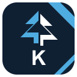

# Kedr



Free, MIT-licensed, local-first development tools with one shared interface
foundation and an independently developed Rust text core. No Kedr account, paid
activation or runtime cloud service is required for the existing desktop preview.

**Available today: CodeCedar, the renamed Kedr Studio editor/workbench preview.**
Every other entry below is a named product plan, not a downloadable application.
No full JetBrains feature-parity claim is made. Names and marks are Kedr originals;
Kedr is not affiliated with JetBrains.

## Start here

- [Download and install CodeCedar on Linux, Windows or macOS](products/codecedar.md)
- [What has actually been delivered](docs/suite/PROGRESS.md)
- [Keyboard profiles and implemented actions](docs/suite/KEYMAP.md)
- [Feature-parity roadmap and acceptance gates](docs/suite/PARITY.md)

```bash
cargo run --locked --release -p kedr-studio -- /path/to/project
```

## Product catalog

Each product has its own logo, Markdown guide, platform availability and explicit
status. Planned entries do not contain fake download buttons or build commands.

| Product | Focus | Comparison category | Status |
| --- | --- | --- | --- |
| [CodeCedar](products/codecedar.md) | Native local editor and shared desktop foundation | Fleet | Desktop preview |
| [IdeaCedar](products/ideacedar.md) | Java, Kotlin and JVM development | IntelliJ IDEA | Planned — no download |
| [PyCedar](products/pycedar.md) | Python development | PyCharm | Planned — no download |
| [WebCedar](products/webcedar.md) | JavaScript and TypeScript development | WebStorm | Planned — no download |
| [PhpCedar](products/phpcedar.md) | PHP development | PhpStorm | Planned — no download |
| [RubyCedar](products/rubycedar.md) | Ruby and Rails development | RubyMine | Planned — no download |
| [GoCedar](products/gocedar.md) | Go development | GoLand | Planned — no download |
| [CppCedar](products/cppcedar.md) | C and C++ development | CLion | Planned — no download |
| [RustCedar](products/rustcedar.md) | Rust development | RustRover | Planned — no download |
| [DotCedar](products/dotcedar.md) | .NET and game development | Rider | Planned — no download |
| [DataCedar](products/datacedar.md) | Database development | DataGrip | Planned — no download |
| [MetaCedar](products/metacedar.md) | Domain-specific language workbench | MPS | Planned — no download |
| [BoxCedar](products/boxcedar.md) | Product installation and update manager | Toolbox App | Planned — no download |
| [SharpCedar](products/sharpcedar.md) | Visual Studio .NET tooling | ReSharper | Planned — no download |
| [SharpCppCedar](products/sharpcppcedar.md) | Visual Studio C++ tooling | ReSharper C++ | Planned — no download |
| [PeekCedar](products/peekcedar.md) | .NET assembly inspection | dotPeek | Planned — no download |
| [TraceCedar](products/tracecedar.md) | Execution performance profiling | dotTrace | Planned — no download |
| [MemoryCedar](products/memorycedar.md) | Memory profiling | dotMemory | Planned — no download |
| [CoverCedar](products/covercedar.md) | Coverage and test investigation | dotCover | Planned — no download |
| [TrackCedar](products/trackcedar.md) | Issue and project management | YouTrack | Planned — no download |
| [BuildCedar](products/buildcedar.md) | Continuous integration service | TeamCity | Planned — no download |
| [HubCedar](products/hubcedar.md) | Shared identity and service connections | Hub | Planned — no download |
| [LabCedar](products/labcedar.md) | Collaborative notebooks and data work | Datalore | Planned — no download |
| [QualityCedar](products/qualitycedar.md) | Code quality platform | Qodana | Planned — no download |
| [PairCedar](products/paircedar.md) | Collaborative development | Code With Me | Planned — no download |
| [GateCedar](products/gatecedar.md) | Remote workspace entry point | Gateway | Planned — no download |
| [CloudCedar](products/cloudcedar.md) | Managed development environments | CodeCanvas | Planned — no download |
| [LearnCedar](products/learncedar.md) | Educational development tooling | JetBrains Academy | Planned — no download |
| [AgentCedar](products/agentcedar.md) | User-controlled coding agent | Junie | Planned — no download |
| [AICedar](products/aicedar.md) | Optional AI development assistance | JetBrains AI | Planned — no download |
| [AirCedar](products/aircedar.md) | Agent workflow coordination | JetBrains Air | Planned — no download |
| [MarketCedar](products/marketcedar.md) | Extension distribution and discovery | Marketplace | Planned — no download |
| [MatterCedar](products/mattercedar.md) | Reserved team-tool product slot | Matter | Planned — no download |

The reference catalog is [JetBrains products](https://www.jetbrains.com/products.html),
with [IDE/AI context](https://www.jetbrains.com/ides/). These are category references,
not assertions of equivalence or exhaustive current-market coverage. Kotlin, Ktor,
Koog, Exposed and Compose Multiplatform belong in language/framework integration
research, not fake downloadable Kedr IDEs. Their reimplementation is not claimed.
MatterCedar requires further scope research before its specification is approved.

## One repository, one interface foundation

```text
src/                     Standard-library-only Rust core
crates/kedr-workbench/    Editing workflows, workspace/search/task services
crates/kedr-ui/           Shared UI, actions, keyboard profiles and viewport editor
apps/studio/             Native host for CodeCedar; package remains kedr-studio
products/                One Markdown guide per product plus catalog.json
assets/brand/            Original editable SVG logos
docs/suite/              Progress, keyboard coverage and parity gates
```

Desktop products reuse `kedr-ui`; server tools require actual service backends
and runtime hosts, not renamed desktop binaries. egui/eframe/rfd provide the
open-source window/UI stack; that third-party stack is not claimed to be written
from scratch. There is no Electron/webview in the current desktop app.

## Core and validation

Persistent AVL text storage, Unicode rank/select, root-sharing undo, immutable
snapshots, guarded edit batches, bounded invalidation and streaming search.

```bash
cargo test --locked --workspace
cargo fmt --all --check
cargo clippy --locked --workspace --all-targets -- -D warnings
cargo bench --locked --bench core
```

[Core API](docs/API.md) · [Architecture](docs/ARCHITECTURE.md) ·
[Hardening](docs/HARDENING.md) · [Historical benchmarks](PERFORMANCE.md) ·
[Desktop validation](docs/studio/VALIDATION.md)

Historical core microbenchmarks are not Studio/IDE performance evidence. Platform
artifacts exist only when their actual Actions job succeeds. Physical Arch/Wayland,
Windows and macOS acceptance is distinct from compilation and headless tests.
