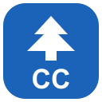

# CodeCedar



A native, local-first development workspace built on the Kedr Rust text core.
**Status: first desktop preview, not a complete JetBrains replacement.**

## What works now

- Project explorer, tabs, quick file navigation and searchable command palette.
- Viewport-only code rendering, basic line syntax colors and configurable dark/light themes.
- UTF-8 editing, Unicode-scalar cursor movement, selections, clipboard, undo/redo,
  autoindent, transactional multiline indentation and literal find/replace.
- Bounded saved-project-file search in the background.
- Explicit save, external-change refusal, unsaved-change guards for close/switch/quit.
- Real Cargo check/test output, only after explicit project trust/confirmation.
- Native folder picker, recent workspaces and appearance preferences.

CodeCedar is the product name of the existing Kedr Studio preview. The current
binary/package remains `kedr-studio` for compatibility; it is not a second app.

The shell and design system live in `kedr-ui`, not a product-specific UI fork.
Future products must reuse that shell, navigation and interaction vocabulary.
There is currently **one desktop product**, not several renamed copies.

## Download preview builds

Open [Studio builds](https://github.com/drainedgodw/kedr/actions/workflows/studio.yml),
select a successful run for the desired commit, and download its platform artifact.
Artifacts are named `kedr-studio-<OS>-<architecture>`. GitHub may require sign-in to
retrieve Actions artifacts. Availability is determined by the actual job result,
not by this guide or a workflow configuration. These are unsigned preview builds;
Linux and Windows preview installers are now built by CI; there is no signed stable release or notarized macOS distribution.

## Install with menu entries and icons

See [installation guide](../docs/suite/INSTALL.md) for the offline Linux selector,
local makepkg/pacman package without AUR registration, and Windows setup wizard.
Only CodeCedar can currently be installed; other catalog products stay disabled.

## Build on Arch Linux

Install Rust 1.88+ and normal desktop graphics/portal dependencies:

```bash
sudo pacman -S --needed rustup base-devel mesa libxkbcommon libxkbcommon-x11 libx11 libxcursor libxi libxrandr xdg-desktop-portal
rustup default stable
git clone https://github.com/drainedgodw/kedr.git
cd kedr
cargo build --locked --release -p kedr-studio
./target/release/kedr-studio /path/to/your/project
```

Install the portal backend appropriate to the desktop, e.g. `xdg-desktop-portal-gtk`
or `xdg-desktop-portal-hyprland`. If the folder picker is unavailable, pass the
workspace directory on the command line. Linux needs a working X11 or Wayland
session and OpenGL driver. Local validation used Linux X11 with software rendering,
not the maintainer's Arch machine or a physical Wayland session.

## Build on Windows

Install Rust stable via rustup and Visual Studio Build Tools with Desktop C++ tools.
In PowerShell:

```powershell
git clone https://github.com/drainedgodw/kedr.git
cd kedr
cargo build --locked --release -p kedr-studio
.\target\release\kedr-studio.exe "C:\Users\you\code\project"
```

Windows/macOS build and model/UI test jobs are configured in Actions. Do not assume
that an unobserved run succeeded. macOS also requires Xcode command-line tools for
source builds; it has not been manually inspected on a physical Mac.

## First five minutes

1. Open a workspace with the welcome button or pass its directory at launch.
2. Browse the explorer or use **Ctrl Shift N** (macOS: **Cmd Shift O**) for files.
3. Use **Ctrl Shift A** / **Cmd Shift A** for commands and **Ctrl F** / **Cmd F** to find.
4. **Ctrl S** / **Cmd S** saves all open files in the compatible profile. Changed-on-disk files are refused, not silently overwritten.
5. **Check / F5** in a Cargo workspace opens an explicit trust decision before execution.
6. Settings → Keyboard shortcuts shows every implemented action and both profiles; Edit records/remaps a single combination.

The default is a JetBrains-compatible subset. Choose Kedr classic to retain Ctrl P,
Ctrl Shift P and save-current-file behavior. Hints adapt to platform/profile; no
complete JetBrains keymap compatibility is claimed. Go to line/column, find previous,
duplicate, delete-line and tab cycling are real operations backed by tests.

## Limits you should know

- No LSP completion, semantic refactoring, debugger, terminal emulator, Git UI,
  plugin runtime, remote development or recovery/autosave implementation yet.
- Syntax colors are a simple line lexer, not a parser/type checker.
- Cursor movement is by Unicode scalars, not grapheme clusters. System-level IME
  integration is implemented but only synthetic composition events were tested.
- Documents are limited to 16 MiB, with 32 open tabs in this preview. A single
  paste is limited to 1 MiB; replace-all to 10,000 matches; indent to 4,096 lines.
- Very long lines use an 8 KiB rendered byte window around the caret. Full contents
  remain in the core and are saved without truncation. No long-line wrapping/minimap.
- Project discovery is bounded. Saved-file search reads up to 1 MiB/file and 32 MiB
  total, returning up to 1,000 hits; it does not search unsaved tab contents.
- Saving is currently synchronous. Cancellation stops the direct Cargo child;
  process-tree cancellation and exit-drain ordering are not guaranteed yet.
- Native widgets expose accessible labels; the custom editor does not yet provide
  a complete screen-reader text/selection model. Default bundled font coverage is
  not all writing systems. There is no accessibility-compliance claim.
- Appearance/recent-path preferences are stored locally. No cloud service,
  telemetry, account or paid activation is required by Kedr.

See [product direction](../docs/studio/PRODUCT.md), [shared UI contract](../docs/studio/DESIGN.md)
and [validation](../docs/studio/VALIDATION.md).

[All Kedr products](../README.md#product-catalog) · [Keyboard profiles](../docs/suite/KEYMAP.md)
