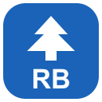

# RubyCedar

Ruby and Rails development. Part of the Kedr family; comparison category: RubyMine.

**Status: planned. There is no RubyCedar application, build artifact or installer yet.**
The name and logo identify a product direction, not delivered feature parity.

## Download

| Platform | Availability |
| --- | --- |
| Linux / Arch | Not released; no installation command yet |
| Windows | Not released; no installer yet |
| macOS | Not released; future CI is not physical-machine acceptance |

Do not download CodeCedar and treat it as RubyCedar. Actual release links and verified
platform-specific commands will be added only after a working build exists.

## Intended capabilities — not implemented

- [ ] Ruby environments and dependency management
- [ ] Ruby/Rails semantic tooling
- [ ] Tests and debugger integration

## Shared interface and shortcuts

Desktop products reuse the Kedr workbench where appropriate; services use the
same visual/interaction contract but need their own service and web/runtime host.
No service is claimed to exist merely because the desktop shell exists.
[Shared UI contract](../docs/studio/DESIGN.md) ·
[Implemented keyboard profiles](../docs/suite/KEYMAP.md) ·
[Parity release gates](../docs/suite/PARITY.md)

## Development

There is no buildable product package for this entry yet. All future code belongs
in this monorepo. Implementation needs a reviewed specification, actual backend,
integration tests, security boundaries and platform validation.

[Back to all Kedr products](../README.md#product-catalog)
